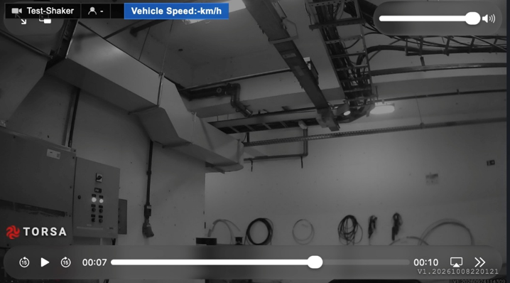
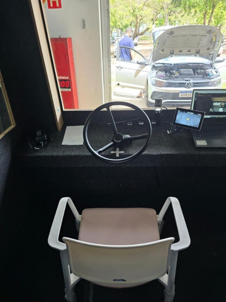
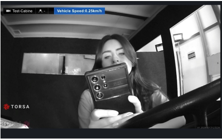
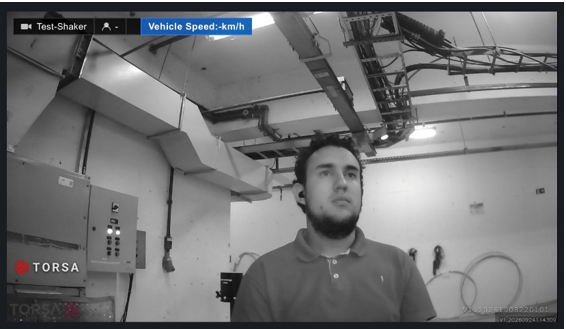
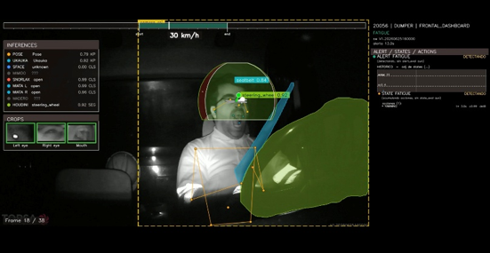
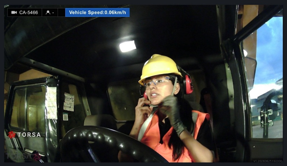

**Control documental:** Versión: 0.1 · Estado: Borrador · Fecha: 2026-10-15 · Clasificación: Confidencial · Portafolio: AO · Tipo: INF · Cliente: Vale · Proyecto: Vale · Nivel mínimo: L3 · Código: ES-AO-INF-RESP-VALE-CPQD (provisional)

## 1. Resumen ejecutivo

Las cuatro observaciones de Vale se originan en diferencias entre el entorno de laboratorio y una cabina en operación, y en una confusión entre calibración y entrenamiento del modelo; TORSA considera que no reflejan una limitación estructural de la solución. TORSA propone contrastar cada punto con evidencia de campo y ejecutar un plan de validación conjunto.

| # | Observación de Vale | Posición técnica de TORSA |
| -- | ------------------ | ------------------------ |
| 1 | La cabina de laboratorio reproduce las dimensiones reales de los equipos | Asiento, espacio interior y volante (móvil en laboratorio) difieren de una cabina real |
| 2 | La calibración depende de conectividad | La calibración no requiere conectividad; solo el entrenamiento del modelo la requiere, durante unos segundos |
| 3 | Sensibilidad excesiva y poca robustez entre cabinas | La comparación se hizo entre una cabina real y un laboratorio distinto; falta contrastar con resultados de campo |
| 4 | 30–60 minutos de calibración por vehículo | En campo: 15 min en el primer equipo y ~5 min en los siguientes (≈17 h para 200 camiones, no 100–200 h) |

## 2. Antecedentes y alcance

Este informe responde a las observaciones que Vale comunicó a SITECH Brasil el 13 de octubre de 2026, en el marco de la homologación de la solución de monitoreo de fatiga y distracción de TORSA, y está pensado como anexo al informe del laboratorio CPQD contratado por Vale.

Cubre cuatro puntos: cabina de laboratorio, dependencia de conectividad, sensibilidad y robustez entre cabinas, y tiempo de calibración por vehículo. La evidencia proviene de las pruebas de campo realizadas en Vale, de imágenes del entorno de laboratorio y de estadísticas de alertas de una operación minera de referencia.

Tras revisar el entorno de pruebas de Vale, TORSA desarrolló y desplegó el 14 de octubre de 2026, según lo comprometido, una versión de software con modelos de IA ajustados a escenarios no declarados inicialmente: fatiga, uso de móvil, consumo de tabaco, distracción, uso del cinturón de seguridad, obstrucción de cámara, presencia del operador, gafas inadecuadas y consumo de alimentos. Estas pruebas aplican un criterio de evaluación distinto del uso operativo habitual, por lo que sus resultados se registran por separado de los de campo.

## 3. Análisis técnico por observación

### 3.1 Cabina de laboratorio y calibración

La cabina del laboratorio no reproduce fielmente las condiciones de un equipo en operación. El asiento, el espacio interior y la posición del volante, que en el laboratorio es móvil, difieren de los de una cabina real (Figuras 1 a 4 del Anexo). Por eso TORSA considera necesario contrastar los resultados de laboratorio con los de operación.

Además, un sistema con sensibilidad muy alta se calibra con facilidad en laboratorio, pero en operación genera una cantidad significativa de alarmas ante situaciones que no representan un riesgo real (sección 4).

### 3.2 Dependencia de conectividad

Hay que distinguir dos procesos:

- **Calibración:** define la ventana de atención del operador (Figura 5). No requiere conectividad.
- **Entrenamiento del modelo:** incorpora evidencia del entorno al modelo de reconocimiento. Sí requiere conectividad, pero toma solo unos segundos.

Luego de la calibración, el sistema funciona en modo autónomo (standalone). TORSA solicitó conexión a red durante las pruebas únicamente para el monitoreo: sin red, la supervisión de Vale no recibe retroalimentación de las alertas y no puede emitir su evaluación del sistema. No se necesita conexión constante para las pruebas, pero sí que las personas vean el resultado de las alertas en algún lugar, porque sin esa visibilidad surgen dudas sobre el funcionamiento del sistema.

### 3.3 Sensibilidad y robustez frente a variaciones entre cabinas

La comparación se hizo entre una cabina real (la instalada en campo, Figura 6) y un entorno de laboratorio que difiere de forma importante de una cabina en operación (Figuras 2 a 4). Por eso no permite medir la robustez entre cabinas.

El modelo de TORSA está entrenado para operar en cabinas reales de camiones, palas y vehículos livianos, en ambientes reales de operación y conducción. Considera el contexto operacional para minimizar falsos positivos y evitar que, tras cada alerta, haya que recurrir a personas para clasificar las distracciones. La instalación en vehículos livianos con una a cuatro personas a bordo es factible.

Una evaluación objetiva de la robustez debe incluir los resultados de las pruebas de campo; TORSA solicita que se incorporen al análisis.

### 3.4 Tiempo de calibración por vehículo

En un entorno operativo real no se requieren 30 a 60 minutos por vehículo. En las pruebas de campo en Vale la calibración tomó 15 minutos en el primer equipo y unos 5 minutos en los siguientes, dentro del mismo proceso de instalación.

| Escenario | Tiempo por vehículo | Flota de 200 camiones |
| --- | --- | --- |
| Estimación de Vale | 30–60 min | 100–200 h |
| Campo en Vale (equipos posteriores al primero) | ~5 min | ~17 h |

## 4. Evidencia: sensibilidad frente a falsos positivos

En una operación minera de referencia, al reactivarse la alerta de distracción el volumen diario subió a unas 4.500 alertas y la precisión de esa alerta bajó de 84 % a 45 %. Los datos incluyen solo alertas con subtipo y video, y excluyen SEATBELT.

**Alertas por día según el periodo del sistema**

| Periodo | Días con datos | Alertas por día (promedio) |
| --- | --- | --- |
| 17 jun 2024 – 22 oct 2025 | 40 | 10.586 |
| 23 oct – 31 dic 2025 | 70 | 3.126 |
| 1 – 27 ene 2026 | 27 | 1.558 |
| 28 ene – 23 mar 2026 | 55 | 1.008 |
| 24 mar – 29 abr 2026 | 37 | 1.818 |
| 30 abr 2026 – último dato | 168 | 4.500 |

El 30 de abril de 2026 el volumen se dispara a unas 4.500 alertas por día, coincidiendo con la reactivación de DISTRACTION (136 mil alertas) y FATIGUE (12 mil).

**Precisión por tipo de alerta, desde el 30 abr 2026**

| Tipo | Revisadas (SÍ + NO) | Precisión (SÍ ÷ revisadas) | Sin validar |
| --- | --- | --- | --- |
| TABACO | 44.069 | 95,7 % | 77 % |
| MOBILE | 55.361 | 94,2 % | 87 % |
| FATIGUE | 6.896 | 75,2 % | 44 % |
| DISTRACTION | 33.037 | 44,7 % | 76 % |

La precisión de DISTRACTION fue de 83,6 % entre el 28 ene y el 23 mar (847 alertas revisadas) y de 36,6 % entre el 24 mar y el 29 abr (469 revisadas). Las dos últimas cifras se basan en menos revisiones y son menos fiables.

Limitaciones: son datos de otra operación y flota, la mayoría de las alertas no está validada y los cortes de periodo son aproximados. La evidencia es ilustrativa y no reemplaza la medición en Vale.

## 5. Acciones técnicas propuestas

TORSA propone seis acciones para cerrar cada observación con evidencia medible. Los responsables son propuestas por rol y las fechas quedan por confirmar con SITECH y CPQD.

| # | Acción | Obs. | Responsable propuesto | Fecha objetivo |
| -- | ---------------------- | ---- | ------------ | ------ |
| 1 | Reunión técnica con Vale (Daniela Miranda) para presentar este informe y resolver dudas | Todas | Dirección Comercial TORSA, con SITECH | Por confirmar |
| 2 | Prueba comparativa: misma persona y misma configuración en cabina real y en cabina de laboratorio, con métricas de alertas | 1 y 3 | Ingeniería de Aplicaciones TORSA, con CPQD | Por confirmar |
| 3 | Entregar a Vale el procedimiento de calibración y la descripción del modo autónomo, y definir con Vale cómo se visualizan los resultados de las alertas cuando no hay red | 2 | Producto TORSA | Por confirmar |
| 4 | Prueba de robustez en varias cabinas (camión, pala y vehículo liviano con 1 a 4 ocupantes), registrando alertas y falsos positivos por cabina | 3 | Ingeniería de Aplicaciones TORSA, con SITECH | Por confirmar |
| 5 | Cronometrar la calibración en campo por vehículo y publicar los tiempos | 4 | SITECH en campo, TORSA en análisis | Por confirmar |
| 6 | Reportar por separado los resultados de pruebas sintéticas (alta sensibilidad) y de campo | 3 | Ingeniería de Aplicaciones TORSA | Por confirmar |

## 6. Conclusiones y próximos pasos

Con la evidencia disponible, TORSA concluye que la calibración no depende de conectividad, que en campo toma unos 5 minutos por vehículo y que el laboratorio difiere de una cabina real en aspectos que afectan la comparación. La robustez entre cabinas y el desempeño en vehículos livianos deben demostrarse con las pruebas propuestas en la sección 5.

TORSA solicita:

- incorporar los resultados de campo en Vale al análisis del CPQD;
- una reunión técnica con Daniela Miranda y su equipo para sustentar cada punto;
- acordar con SITECH y CPQD las fechas y responsables del plan de la sección 5.

## Anexo. Figuras de referencia

Imágenes citadas en las secciones 3.1 a 3.3, provenientes de las pruebas de TORSA en laboratorio y en campo en Vale.

{width=60%}

{width=45%}

{width=60%}

{width=60%}

{width=60%}

{width=60%}
